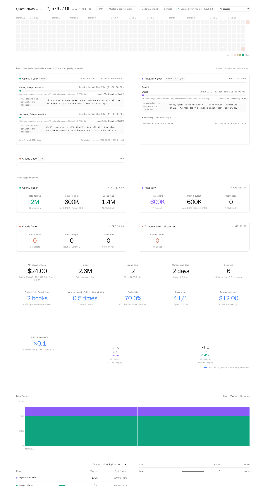

# QuotaCanvas

English · [繁體中文](README.md)

A browser dashboard for local Codex, Antigravity, Claude Code, and DeepSeek Harness usage. For supported agents, it also displays quotas, reads conversations, and schedules messages.

**v0.0.1 · Linux / Windows x64 · [MIT License](LICENSE)**



## Install and start

### Windows (x64)

1. Download `QuotaCanvas-v0.0.1-windows-x64.zip` from GitHub **Releases** and extract the entire folder.
2. Double-click `QuotaCanvas.exe` and set a dashboard password on first launch. Python is included.
3. Click **Open local dashboard** or visit [http://127.0.0.1:8088](http://127.0.0.1:8088). Closing the main window stops the service.

Use the main window to change your password, start QuotaCanvas at sign-in, or show the tok/s overlay. To monitor another host, select **Remote** under **Monitor source**, then enter its dashboard URL and password. For a host protected by Cloudflare Access, select **Verify Access in browser**. Settings and history are stored in `%LOCALAPPDATA%\QuotaCanvas` and survive app updates.

### Linux

Requires Python 3.10 or later. On Debian or Ubuntu, run `sudo apt install python3-venv` if virtual environments are unavailable.

```bash
git clone https://github.com/iezx/QuotaCanvas.git
cd QuotaCanvas
python3 -m venv .venv
. .venv/bin/activate
python -m pip install -r requirements.txt
python server.py
```

Set a 10–256 character dashboard password when prompted. Open [http://127.0.0.1:8088](http://127.0.0.1:8088) and sign in. Press Ctrl+C to stop the service.

Run QuotaCanvas under the same Linux account you use for your agents. The default log homes are `~/.codex`, `~/.gemini/antigravity-cli`, `~/.claude`, and `~/.dsh`. Override them with `CODEX_HOME`, `AGY_HOME`, `CLAUDE_HOME`, and `DSH_HOME`.

## Use the dashboard

- **Usage overview** shows tokens, API-equivalent costs, and recent output rates. Sort models by tokens or cost. Model IDs come from the logs, and unpriced models still count toward token totals.
- **Models & API pricing** lets you select a known model or enter a custom ID. Set input, cache-read, cache-write, and output prices in USD per million tokens. Saving recalculates estimates.
- **Price research** supports one-off or scheduled lookups with a local agent. To use another AI, copy the prompt from the pricing page and import its JSON response. Check the source, then select **Apply suggestion**.
- **Local conversations** lets you read, create, continue, and schedule messages for supported agents. Native Codex questions appear below the conversation. Enter `/help` for commands supported by the selected agent.
- **Settings** shows finished-task output rates and quota exhaustion history. You can also hide email addresses, set subscription dates, and limit failed sign-in attempts.

## Linux command reference

Activate `.venv` in the project folder. Stop the existing process before changing startup flags or running administrative commands.

| Command | Action |
| --- | --- |
| `python server.py` | Start on `127.0.0.1:8088` |
| `python server.py --lan-host 192.168.1.10` | Listen on loopback and the specified private IPv4 address. Use your host’s LAN address |
| `python server.py --host 0.0.0.0` | Listen on all IPv4 interfaces. Use a firewall and an HTTPS reverse proxy for direct public access |
| `python server.py --port 9090 --interval 60` | Use port 9090 and refresh usage every 60 seconds |
| `python server.py --set-password` | Reset the dashboard password interactively, then restart the service |
| `python server.py --disable-remote` | Persistently stop the tunnel connection and retain Cloudflare Access settings |
| `python server.py --once` | Collect once, print the summary, and exit |
| `python server.py --web-cache "$HOME/.cache/quotacanvas/web"` | Serve static pages from a snapshot on local disk |
| `python server.py --help` | List all startup options |

Keep `data/` when updating. If your project disk cannot enforce private permissions, set `export QUOTACANVAS_DATA_DIR="$HOME/.local/share/quotacanvas"` and use the same path for startup and password resets.

## Windows command reference

Open PowerShell in the extracted folder and close the running QuotaCanvas app first.

| Command | Action |
| --- | --- |
| `.\QuotaCanvas.exe --lan-host 192.168.1.10` | Keep loopback and listen on this private IPv4 address. Substitute your host’s LAN address |
| `.\QuotaCanvas.exe --port 9090` | Use port 9090 |
| `.\QuotaCanvas.exe --set-password` | Open the password reset dialog, then reopen the app after saving |
| `.\QuotaCanvas.exe --disable-remote` | Persistently stop the tunnel and retain Cloudflare Access settings |
| `.\QuotaCanvas.exe --help` | List startup options |

## Remote access through Cloudflare

### Install cloudflared

Install it on the host running QuotaCanvas. These commands apply to Debian and Ubuntu. For other Linux distributions, follow the matching package instructions. [Cloudflare package repository](https://pkg.cloudflare.com/index.html)

```bash
sudo install -d -m 0755 /usr/share/keyrings
curl -fsSL https://pkg.cloudflare.com/cloudflare-main.gpg | sudo tee /usr/share/keyrings/cloudflare-main.gpg >/dev/null
echo 'deb [signed-by=/usr/share/keyrings/cloudflare-main.gpg] https://pkg.cloudflare.com/cloudflared any main' | sudo tee /etc/apt/sources.list.d/cloudflared.list
sudo apt update
sudo apt install cloudflared
cloudflared --version
```

**Windows** users can install the x64 MSI. Reopen PowerShell and run `cloudflared --version`, then restart QuotaCanvas and follow the steps below. [Official Cloudflare downloads](https://developers.cloudflare.com/tunnel/downloads/#windows)

### Configure Tunnel + Access

1. Use a domain with Cloudflare-hosted DNS and an unused hostname such as `dashboard.example.com`. Set up a login method in Zero Trust, such as a one-time email code.
2. Create a custom API token. Limit its account and zone resources to the target account and domain. [Create an API token](https://developers.cloudflare.com/fundamentals/api/get-started/create-token/)
3. In QuotaCanvas **Settings → Cloudflare Tunnel + Access**, enter the hostname, allowed email addresses, and API token. Select **Save → Check configuration → Enable**.
4. Once the tunnel is connected, open the HTTPS hostname. Complete the Cloudflare Access login, then sign in to QuotaCanvas.

| Scope | Token permission | Level |
| --- | --- | --- |
| Zone | Zone | Read |
| Zone | DNS | Edit |
| Account | Cloudflare Tunnel | Edit |
| Account | Access: Apps and Policies | Edit |
| Account | Access: Organizations, Identity Providers, and Groups | Read |

If Cloudflare lists **Access: Apps** and **Access: Policies** separately, give both Edit. The final permission may appear as **Access: Organizations**.

Allow outbound TCP or UDP 7844 for `cloudflared`. The tunnel uses loopback as its origin, and you can keep a separate LAN entry with `--lan-host`. Grant access only to people you trust to send instructions to your local agents. [Cloudflare connectivity checks](https://developers.cloudflare.com/cloudflare-one/networks/connectors/cloudflare-tunnel/troubleshoot-tunnels/connectivity-prechecks/)

### Start at boot or stop remote access

Turn on **Connect tunnel when QuotaCanvas starts** in Settings to reconnect an enabled tunnel at startup. With the option off, select **Connect tunnel** from the local or LAN dashboard. Select **Disable** to stop the current tunnel connection.

To start the dashboard at boot on Linux, install the project and its `.venv` in `~/.local/opt/quotacanvas`. Start it manually once to set the password. Save the following as `~/.config/systemd/user/quotacanvas.service`.

```ini
[Unit]
Description=QuotaCanvas

[Service]
WorkingDirectory=%h/.local/opt/quotacanvas
ExecStart=%h/.local/opt/quotacanvas/.venv/bin/python server.py
Restart=on-failure

[Install]
WantedBy=default.target
```

```bash
loginctl enable-linger "$USER"
systemctl --user daemon-reload
systemctl --user enable --now quotacanvas.service
```

Check the service with `systemctl --user status quotacanvas.service`. To stop it and turn off startup, run `systemctl --user disable --now quotacanvas.service`.
