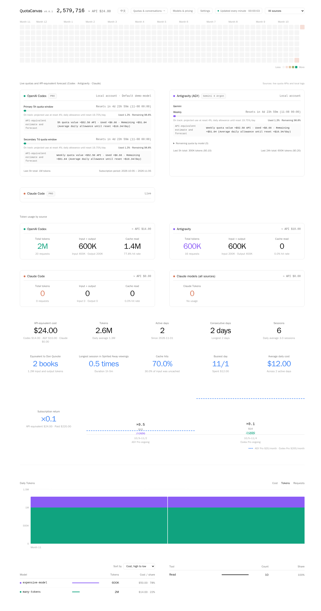

# QuotaCanvas

简体中文 · [繁體中文](README.zh-TW.md) · [English](README.en.md)

在浏览器查看 Codex、Antigravity、Claude Code 和 DeepSeek Harness 的本机 AI 用量。对于受支持的 Agent，还可以查看额度、阅读对话和定时发送消息。

**v0.0.2 · Linux / Windows x64 · [MIT 许可证](LICENSE)**



## 安装与启动

### Windows（x64）

1. 在 GitHub **Releases** 下载 `QuotaCanvas-v0.0.2-windows-x64.zip`，完整解压。
2. 双击 `QuotaCanvas.exe`，首次启动时设置面板密码。安装包已包含 Python。
3. 点击「打开本机面板」，或在浏览器访问 [http://127.0.0.1:8088](http://127.0.0.1:8088)。关闭主窗口会停止服务。

在主窗口可以修改密码、设置登录 Windows 后自动启动，以及打开 tok/s 悬浮窗。要监控另一台主机，在「监控来源」选择「远程」，输入对方的面板网址和密码。如果远程入口使用 Cloudflare Access，再点击「在浏览器中验证 Access」。设置和历史记录保存在 `%LOCALAPPDATA%\QuotaCanvas`，更新时保留该目录。

### Linux

#### 一键安装与自动升级

需要 systemd、Git 和 Python 3.10+（含 `venv`）。Debian / Ubuntu 缺少依赖时，先执行 `sudo apt install git python3-venv`。用运行 Agent 的普通 Linux 用户执行：

```bash
git clone https://github.com/iezx/QuotaCanvas.git "$HOME/QuotaCanvas" &&
  bash "$HOME/QuotaCanvas/install.sh"
```

**首次安装必须在终端设置并确认 10–256 个字符的面板密码。** 密码保存成功后，脚本才会安装 Python 依赖、启动面板和启用自动升级。取消或未完成会停止安装，可以重新运行脚本。已有有效密码会继续使用。默认把数据保存到 `~/.local/share/quotacanvas`，启用 `quotacanvas.service` 开机启动，并每天检查 Git 更新。打开 [http://127.0.0.1:8088](http://127.0.0.1:8088) 登录。

如果已经克隆，在原目录执行 `QUOTACANVAS_INSTALL_DIR="$PWD" bash install.sh`。如果用过自定义 `QUOTACANVAS_DATA_DIR`，先设为原来的绝对路径。已有自定义同名服务可继续按下方手动升级步骤维护。

每天先核对本机和上游的版本号及 Git 提交。提交相同就跳过，上游版本较旧也会跳过。同一版本有新的上游提交时，可以照常快进更新。确认有可安装的更新后，脚本会备份数据到 `~/.local/state/quotacanvas-backups`，更新代码，并重启正在运行的面板。可以用 `systemctl --user start quotacanvas-update.service` 立即检查，用 `systemctl --user disable --now quotacanvas-update.timer` 关闭定时更新。已经用旧脚本安装的用户，更新到本版后重新运行一次 `install.sh`，让已安装的更新服务使用新的版本检查规则。

#### 手动安装

需要 Python 3.10 或更新版本。Debian / Ubuntu 如缺少虚拟环境支持，先执行 `sudo apt install python3-venv`。

```bash
git clone https://github.com/iezx/QuotaCanvas.git
cd QuotaCanvas
python3 -m venv .venv
. .venv/bin/activate
python -m pip install -r requirements.txt
python server.py
```

首次启动时，在终端设置 10–256 个字符的密码。打开 [http://127.0.0.1:8088](http://127.0.0.1:8088) 并登录。按 Ctrl+C 停止服务。

使用同一个 Linux 用户登录 Agent 和运行 QuotaCanvas。日志默认位于 `~/.codex`、`~/.gemini/antigravity-cli`、`~/.claude` 和 `~/.dsh`。可以用 `CODEX_HOME`、`AGY_HOME`、`CLAUDE_HOME` 和 `DSH_HOME` 指定其他位置。

### 持久化 Linux 数据

默认数据目录是安装目录下的 `data/`。建议把面板密码、价格、计划任务、历史记录和 Cloudflare 配置放在独立的本机目录。以下命令在运行面板的 Linux 用户下执行。

```bash
install -d -m 700 "$HOME/.local/share/quotacanvas"
export QUOTACANVAS_DATA_DIR="$HOME/.local/share/quotacanvas"
```

迁移已有安装时，先停止面板，再确认目标目录为空，然后在原安装目录运行 `cp -a -- data/. "$QUOTACANVAS_DATA_DIR/"`。如果已经使用自定义数据目录，继续沿用该路径即可。Agent 的原始对话和日志存放在各自的目录，迁移到另一台主机时需要单独备份。

之后从终端启动或重设密码时，先设置相同的 `QUOTACANVAS_DATA_DIR`。开机启动则在 systemd 服务里设置该路径。

### 使用 systemd 开机启动

以同一个 Linux 用户在安装目录手动执行一次 `.venv/bin/python server.py`。确认能登录后按 Ctrl+C。用 `mkdir -p ~/.config/systemd/user` 创建目录，将以下内容保存为 `~/.config/systemd/user/quotacanvas.service`。

```ini
[Unit]
Description=QuotaCanvas

[Service]
WorkingDirectory=%h/QuotaCanvas
Environment=QUOTACANVAS_DATA_DIR=%h/.local/share/quotacanvas
Environment=PATH=%h/.local/bin:/usr/local/bin:/usr/bin:/bin
ExecStart=%h/QuotaCanvas/.venv/bin/python server.py
Restart=on-failure

[Install]
WantedBy=default.target
```

示例假设程序安装在 `~/QuotaCanvas`。按实际安装位置调整 `WorkingDirectory` 和 `ExecStart`。使用自定义数据路径时，调整 `Environment` 中的 `QUOTACANVAS_DATA_DIR`。如果 Agent 或 cloudflared 安装在其他位置，将其目录加入 `PATH`。原来使用的 `--lan-host` 等参数追加在 `server.py` 后面。

```bash
sudo loginctl enable-linger "$(id -un)"
systemctl --user daemon-reload
systemctl --user enable --now quotacanvas.service
systemctl --user status quotacanvas.service
```

`enable-linger` 让用户服务在开机后启动，并在退出登录后继续运行。用 `journalctl --user -u quotacanvas.service -n 50` 查看日志，用 `systemctl --user disable --now quotacanvas.service` 停止服务并关闭开机启动。

### 升级 Linux 上的已有安装

1. 停止面板。终端启动的实例按 Ctrl+C。使用上面的 systemd 用户服务时，执行 `systemctl --user stop quotacanvas.service`。使用系统服务时，执行 `sudo systemctl stop <服务名>`。
2. 用原来的 Linux 用户进入已有的 QuotaCanvas 安装目录。如果启动时设置过 `QUOTACANVAS_DATA_DIR`，先在当前终端设为同一个绝对路径。先执行 `git status --short --branch`，若有源码改动，先保存改动再继续。下面的命令会先备份数据，再更新代码和依赖。

   ```bash
   data_dir="${QUOTACANVAS_DATA_DIR:-$PWD/data}"
   backup_dir=$(mktemp -d "$HOME/quotacanvas-backup.XXXXXX") &&
     cp -a -- "$data_dir" "$backup_dir/data" &&
     printf '%s\n' "$backup_dir" &&
     git pull --ff-only &&
     .venv/bin/python -m pip install -r requirements.txt
   ```

3. 上面的命令全部成功后，用原来的参数启动。默认命令是 `.venv/bin/python server.py`。使用 systemd 时，保留原数据路径和启动参数。用户服务执行 `systemctl --user start quotacanvas.service`，系统服务执行 `sudo systemctl start <服务名>`。刷新面板，用原密码登录。

若原来从源码压缩包安装，停止面板并备份数据目录后，解压新版到新目录，按上面的 Linux 安装步骤重建 `.venv`。把旧安装的 `data/` 复制到新目录，或继续使用原来的 `QUOTACANVAS_DATA_DIR`。如果用 systemd 且安装路径变了，把服务的工作目录和启动命令改为新路径，用 `systemctl --user daemon-reload`（用户服务）或 `sudo systemctl daemon-reload`（系统服务）重新加载后再启动。保留旧目录，直到新版验证完成。

## 使用面板

- **用量总览**显示 tokens、API 等价费用和近期输出速度，可以按 tokens 或费用对模型排序。模型 ID 来自日志，未定价的模型仍计入 tokens。
- **模型与 API 价格**支持选择已有模型或输入自定义 ID。可以手动设置输入、缓存读、缓存写和输出价格，单位为 USD / 100 万 tokens。保存后重新计算费用。
- **查价**支持调用本机 Agent 或定时查询。也可以复制提示词给其他 AI，再导入返回的 JSON。核对来源后点击「应用建议」生效。
- **本机对话**支持阅读、创建和继续对话，以及定时发送消息。Codex 原生提问显示在对话下方。输入 `/help` 查看当前 Agent 支持的命令。
- **设置**可查看已完成任务的平均 tok/s 和额度耗尽记录，也可以隐藏邮箱、设置订阅日期和限制登录失败次数。

默认价格来自项目中的 `model_prices.json`。手动价格和查价建议保存在 `data/prices.json`。可按供应商缩小查价范围。开启定时查价后，价格页会显示下次检查时间，结果需确认后应用。官方已公布的内置费率会按用量时间和 UTC 生效日期计算，手动价格优先。

## Linux 命令参考

在项目目录激活 `.venv` 后执行。更换启动参数或执行管理命令前，先停止正在运行的服务。

| 命令 | 用途 |
| --- | --- |
| `python server.py` | 启动面板，默认只监听 `127.0.0.1:8088` |
| `python server.py --lan-host 192.168.1.10` | 同时监听本机和指定的内网 IPv4。请换成主机的实际地址 |
| `python server.py --host 0.0.0.0` | 监听所有 IPv4 接口。直接对外提供服务时，由防火墙和 HTTPS 反向代理保护入口 |
| `python server.py --port 9090 --interval 60` | 使用 9090 端口，每 60 秒更新用量 |
| `python server.py --set-password` | 在终端重置密码，完成后重新启动面板 |
| `python server.py --disable-remote` | 持久停用 Tunnel 连接，保留 Cloudflare Access 设置 |
| `python server.py --once` | 采集一次，输出摘要后退出 |
| `python server.py --web-cache "$HOME/.cache/quotacanvas/web"` | 使用本地磁盘上的静态页面快照 |
| `python server.py --help` | 查看全部启动参数 |

## Windows 命令参考

先关闭正在运行的 QuotaCanvas，再在解压目录打开 PowerShell。

| 命令 | 用途 |
| --- | --- |
| `.\QuotaCanvas.exe --lan-host 192.168.1.10` | 保留本机入口并监听指定的内网 IPv4。请换成主机的实际地址 |
| `.\QuotaCanvas.exe --port 9090` | 使用 9090 端口 |
| `.\QuotaCanvas.exe --set-password` | 打开密码重置窗口，保存后重新打开程序 |
| `.\QuotaCanvas.exe --disable-remote` | 持久停用 Tunnel 连接，保留 Cloudflare Access 设置 |
| `.\QuotaCanvas.exe --help` | 查看启动参数 |

## 通过 Cloudflare 从外网访问

### 安装 cloudflared

在运行面板的主机上安装。Debian / Ubuntu 可以执行以下命令。其他 Linux 发行版请在软件包页面选择对应的安装方式。 [Cloudflare 官方软件包](https://pkg.cloudflare.com/index.html)

```bash
sudo install -d -m 0755 /usr/share/keyrings
curl -fsSL https://pkg.cloudflare.com/cloudflare-main.gpg | sudo tee /usr/share/keyrings/cloudflare-main.gpg >/dev/null
echo 'deb [signed-by=/usr/share/keyrings/cloudflare-main.gpg] https://pkg.cloudflare.com/cloudflared any main' | sudo tee /etc/apt/sources.list.d/cloudflared.list
sudo apt update
sudo apt install cloudflared
cloudflared --version
```

**Windows** 用户可以安装 x64 MSI。重新打开 PowerShell 并运行 `cloudflared --version`，确认可用后重启 QuotaCanvas。 [Cloudflare 官方下载](https://developers.cloudflare.com/tunnel/downloads/#windows)

### 配置 Tunnel + Access

1. 准备一个由 Cloudflare 托管 DNS 的域名，选择尚未使用的子域名，例如 `dashboard.example.com`。在 Zero Trust 配置邮箱验证码或其他登录方式。
2. 创建自定义 API Token，将账户和 Zone 资源分别限制在目标账户和域名。 [创建 API Token](https://developers.cloudflare.com/fundamentals/api/get-started/create-token/)
3. 在 QuotaCanvas **设置 → Cloudflare Tunnel + Access** 填写子域名、允许登录的邮箱和 API Token。依次点击「保存 → 检查配置 → 启用」。
4. 显示「隧道已连接」后，用浏览器打开 HTTPS 域名。完成 Cloudflare Access 验证，再登录面板。

| 范围 | Token 权限 | 级别 |
| --- | --- | --- |
| Zone | Zone | Read |
| Zone | DNS | Edit |
| Account | Cloudflare Tunnel | Edit |
| Account | Access: Apps and Policies | Edit |
| Account | Access: Organizations, Identity Providers, and Groups | Read |

如果 **Access: Apps** 和 **Access: Policies** 分开显示，两项都选 Edit。最后一项也可能显示为 **Access: Organizations**。

允许 `cloudflared` 通过 TCP 或 UDP 7844 发起出站连接。Tunnel 连接本机回环地址，可以用 `--lan-host` 保留单独的内网入口。面板能向本机 Agent 发送指令，请只授权可信用户。 [Cloudflare 网络连接检查](https://developers.cloudflare.com/cloudflare-one/networks/connectors/cloudflare-tunnel/troubleshoot-tunnels/connectivity-prechecks/)

### 隧道自动连接和停用

在设置中打开「面板启动时自动连接隧道」，已启用的 Tunnel 会在面板启动后自动连接。关闭此选项后，可以从本机或内网点击「启动连接」。要立即断开公网入口，点击「停用」。
