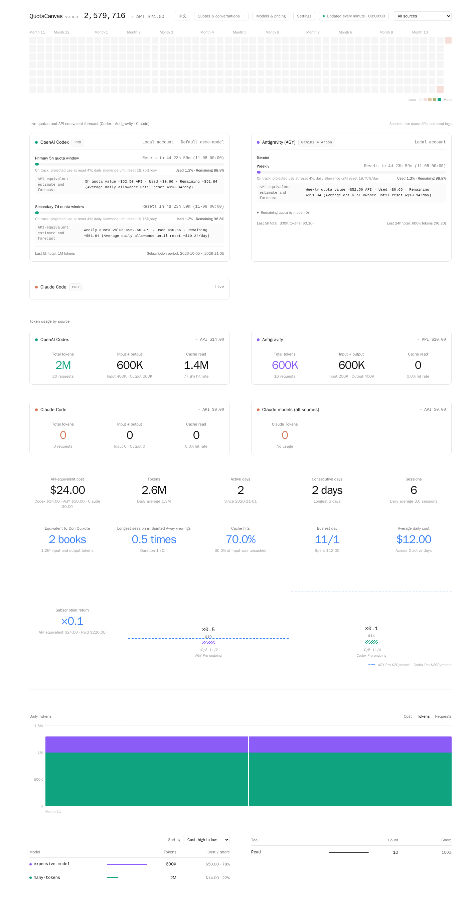

# QuotaCanvas

简体中文 · [繁體中文](README.zh-TW.md) · [English](README.en.md)

在浏览器查看 Codex、Antigravity、Claude Code 和 DeepSeek Harness 的本机 AI 用量。对于受支持的 Agent，还可以查看额度、阅读对话和定时发送消息。

**v0.0.1 · Linux / Windows x64 · [MIT 许可证](LICENSE)**



## 安装与启动

### Windows（x64）

1. 在 GitHub **Releases** 下载 `QuotaCanvas-v0.0.1-windows-x64.zip`，完整解压。
2. 双击 `QuotaCanvas.exe`，首次启动时设置面板密码。安装包已包含 Python。
3. 点击「打开本机面板」，或在浏览器访问 [http://127.0.0.1:8088](http://127.0.0.1:8088)。关闭主窗口会停止服务。

在主窗口可以修改密码、设置登录 Windows 后自动启动，以及打开 tok/s 悬浮窗。要监控另一台主机，在「监控来源」选择「远程」，输入对方的面板网址和密码。如果远程入口使用 Cloudflare Access，再点击「在浏览器中验证 Access」。设置和历史记录保存在 `%LOCALAPPDATA%\QuotaCanvas`，更新时保留该目录。

### Linux

需要 Python 3.10 或更新版本。Debian / Ubuntu 如缺少虚拟环境支持，先执行 `sudo apt install python3-venv`。

```bash
git clone https://github.com/iezx/QuotaCanvas.git
cd QuotaCanvas
python3 -m venv .venv
. .venv/bin/activate
python -m pip install -r requirements.txt
python server.py
```

首次启动时，在终端设置 10–256 个字符的密码。打开 [http://127.0.0.1:8088](http://127.0.0.1:8088) 并登录。按 Ctrl+C 停止服务。

使用同一个 Linux 用户登录 Agent 和运行 QuotaCanvas。日志默认位于 `~/.codex`、`~/.gemini/antigravity-cli`、`~/.claude` 和 `~/.dsh`。可以用 `CODEX_HOME`、`AGY_HOME`、`CLAUDE_HOME` 和 `DSH_HOME` 指定其他位置。

## 使用面板

- **用量总览**显示 tokens、API 等价费用和近期输出速度，可以按 tokens 或费用对模型排序。模型 ID 来自日志，未定价的模型仍计入 tokens。
- **模型与 API 价格**支持选择已有模型或输入自定义 ID。可以手动设置输入、缓存读、缓存写和输出价格，单位为 USD / 100 万 tokens。保存后重新计算费用。
- **查价**支持调用本机 Agent 或定时查询。也可以复制提示词给其他 AI，再导入返回的 JSON。核对来源后点击「应用建议」生效。
- **本机对话**支持阅读、创建和继续对话，以及定时发送消息。Codex 原生提问显示在对话下方。输入 `/help` 查看当前 Agent 支持的命令。
- **设置**可查看已完成任务的平均 tok/s 和额度耗尽记录，也可以隐藏邮箱、设置订阅日期和限制登录失败次数。

## Linux 命令参考

在项目目录激活 `.venv` 后执行。更换启动参数或执行管理命令前，先停止正在运行的服务。

| 命令 | 用途 |
| --- | --- |
| `python server.py` | 启动面板，默认只监听 `127.0.0.1:8088` |
| `python server.py --lan-host 192.168.1.10` | 同时监听本机和指定的内网 IPv4。请换成主机的实际地址 |
| `python server.py --host 0.0.0.0` | 监听所有 IPv4 接口。直接对外提供服务时，由防火墙和 HTTPS 反向代理保护入口 |
| `python server.py --port 9090 --interval 60` | 使用 9090 端口，每 60 秒更新用量 |
| `python server.py --set-password` | 在终端重置密码，完成后重新启动面板 |
| `python server.py --disable-remote` | 持久停用 Tunnel 连接，保留 Cloudflare Access 设置 |
| `python server.py --once` | 采集一次，输出摘要后退出 |
| `python server.py --web-cache "$HOME/.cache/quotacanvas/web"` | 使用本地磁盘上的静态页面快照 |
| `python server.py --help` | 查看全部启动参数 |

更新时保留 `data/`。如果项目所在磁盘无法限制数据目录权限，使用 `export QUOTACANVAS_DATA_DIR="$HOME/.local/share/quotacanvas"`，并在每次启动和重置密码时使用同一路径。

## Windows 命令参考

先关闭正在运行的 QuotaCanvas，再在解压目录打开 PowerShell。

| 命令 | 用途 |
| --- | --- |
| `.\QuotaCanvas.exe --lan-host 192.168.1.10` | 保留本机入口并监听指定的内网 IPv4。请换成主机的实际地址 |
| `.\QuotaCanvas.exe --port 9090` | 使用 9090 端口 |
| `.\QuotaCanvas.exe --set-password` | 打开密码重置窗口，保存后重新打开程序 |
| `.\QuotaCanvas.exe --disable-remote` | 持久停用 Tunnel 连接，保留 Cloudflare Access 设置 |
| `.\QuotaCanvas.exe --help` | 查看启动参数 |

## 通过 Cloudflare 从外网访问

### 安装 cloudflared

在运行面板的主机上安装。Debian / Ubuntu 可以执行以下命令。其他 Linux 发行版请在软件包页面选择对应的安装方式。 [Cloudflare 官方软件包](https://pkg.cloudflare.com/index.html)

```bash
sudo install -d -m 0755 /usr/share/keyrings
curl -fsSL https://pkg.cloudflare.com/cloudflare-main.gpg | sudo tee /usr/share/keyrings/cloudflare-main.gpg >/dev/null
echo 'deb [signed-by=/usr/share/keyrings/cloudflare-main.gpg] https://pkg.cloudflare.com/cloudflared any main' | sudo tee /etc/apt/sources.list.d/cloudflared.list
sudo apt update
sudo apt install cloudflared
cloudflared --version
```

**Windows** 用户可以安装 x64 MSI。重新打开 PowerShell 并运行 `cloudflared --version`，确认可用后重启 QuotaCanvas。 [Cloudflare 官方下载](https://developers.cloudflare.com/tunnel/downloads/#windows)

### 配置 Tunnel + Access

1. 准备一个由 Cloudflare 托管 DNS 的域名，选择尚未使用的子域名，例如 `dashboard.example.com`。在 Zero Trust 配置邮箱验证码或其他登录方式。
2. 创建自定义 API Token，将账户和 Zone 资源分别限制在目标账户和域名。 [创建 API Token](https://developers.cloudflare.com/fundamentals/api/get-started/create-token/)
3. 在 QuotaCanvas **设置 → Cloudflare Tunnel + Access** 填写子域名、允许登录的邮箱和 API Token。依次点击「保存 → 检查配置 → 启用」。
4. 显示「隧道已连接」后，用浏览器打开 HTTPS 域名。完成 Cloudflare Access 验证，再登录面板。

| 范围 | Token 权限 | 级别 |
| --- | --- | --- |
| Zone | Zone | Read |
| Zone | DNS | Edit |
| Account | Cloudflare Tunnel | Edit |
| Account | Access: Apps and Policies | Edit |
| Account | Access: Organizations, Identity Providers, and Groups | Read |

如果 **Access: Apps** 和 **Access: Policies** 分开显示，两项都选 Edit。最后一项也可能显示为 **Access: Organizations**。

允许 `cloudflared` 通过 TCP 或 UDP 7844 发起出站连接。Tunnel 连接本机回环地址，可以用 `--lan-host` 保留单独的内网入口。面板能向本机 Agent 发送指令，请只授权可信用户。 [Cloudflare 网络连接检查](https://developers.cloudflare.com/cloudflare-one/networks/connectors/cloudflare-tunnel/troubleshoot-tunnels/connectivity-prechecks/)

### 开机启动和停用

在设置中打开「面板启动时自动连接隧道」，已启用的 Tunnel 会在面板启动后自动连接。关闭此选项后，可以从本机或内网点击「启动连接」。要立即断开公网入口，点击「停用」。

要让面板随 Linux 开机启动，把项目及其 `.venv` 安装在 `~/.local/opt/quotacanvas`，先手动启动一次并设置密码。将下列内容保存为 `~/.config/systemd/user/quotacanvas.service`。

```ini
[Unit]
Description=QuotaCanvas

[Service]
WorkingDirectory=%h/.local/opt/quotacanvas
ExecStart=%h/.local/opt/quotacanvas/.venv/bin/python server.py
Restart=on-failure

[Install]
WantedBy=default.target
```

```bash
loginctl enable-linger "$USER"
systemctl --user daemon-reload
systemctl --user enable --now quotacanvas.service
```

运行 `systemctl --user status quotacanvas.service` 查看服务状态。运行 `systemctl --user disable --now quotacanvas.service` 停止面板并关闭开机启动。
