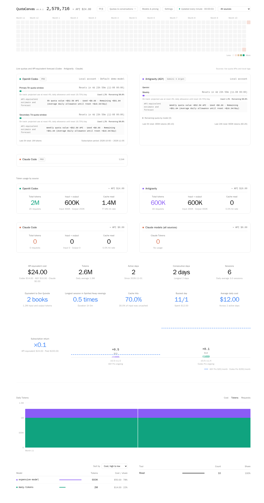

# QuotaCanvas

[简体中文](README.md) · 繁體中文 · [English](README.en.md)

在瀏覽器查看 Codex、Antigravity、Claude Code 和 DeepSeek Harness 的本機 AI 用量。支援的 Agent 還可顯示額度、讀取對話和排程發送訊息。

**v0.0.2 · Linux / Windows x64 · [MIT 授權](LICENSE)**



## 安裝與啟動

### Windows（x64）

1. 在 GitHub **Releases** 下載 `QuotaCanvas-v0.0.2-windows-x64.zip`，解壓整個資料夾。
2. 雙擊 `QuotaCanvas.exe`。首次啟動會要求設定面板密碼，無需安裝 Python。
3. 點「打开本机面板」，或在瀏覽器開啟 [http://127.0.0.1:8088](http://127.0.0.1:8088)。關閉主視窗會停止服務。

可在主視窗修改密碼、設定登入 Windows 後自動啟動，以及開啟 tok/s 懸浮窗。要監看其他主機，在「监控来源」選「远程」，填入對方的面板網址及密碼。若遠端入口使用 Cloudflare Access，再按「在浏览器中验证 Access」。設定與歷史存放在 `%LOCALAPPDATA%\QuotaCanvas`，更新時可保留。

### Linux

需要 Python 3.10 或更新版本。Debian / Ubuntu 如缺少虛擬環境支援，先執行 `sudo apt install python3-venv`。

```bash
git clone https://github.com/iezx/QuotaCanvas.git
cd QuotaCanvas
python3 -m venv .venv
. .venv/bin/activate
python -m pip install -r requirements.txt
python server.py
```

首次啟動時，在終端設定 10–256 字元的密碼。瀏覽 [http://127.0.0.1:8088](http://127.0.0.1:8088) 並登入。按 Ctrl+C 停止服務。

用同一個 Linux 帳戶登入 Agent 和執行 QuotaCanvas。日誌預設位於 `~/.codex`、`~/.gemini/antigravity-cli`、`~/.claude` 和 `~/.dsh`。其他位置可用 `CODEX_HOME`、`AGY_HOME`、`CLAUDE_HOME` 和 `DSH_HOME` 指定。

### 持久化 Linux 資料

預設資料目錄是安裝目錄下的 `data/`。建議把面板密碼、價格、排程、歷史紀錄及 Cloudflare 設定放在獨立的本機目錄。以下命令由執行面板的 Linux 帳戶操作。

```bash
install -d -m 700 "$HOME/.local/share/quotacanvas"
export QUOTACANVAS_DATA_DIR="$HOME/.local/share/quotacanvas"
```

要遷移既有安裝，先停止面板並確認目標目錄是空的，再於原安裝目錄執行 `cp -a -- data/. "$QUOTACANVAS_DATA_DIR/"`。若已使用自訂資料目錄，繼續沿用該路徑即可。Agent 的原始對話和日誌存放在各自的目錄，遷移到另一台主機時需要另外備份。

日後從終端啟動或重設密碼時，先設定相同的 `QUOTACANVAS_DATA_DIR`。開機啟動則在 systemd 服務裡設定該路徑。

### 使用 systemd 開機啟動

在安裝目錄用同一個 Linux 帳戶手動執行一次 `.venv/bin/python server.py`。確認能登入後按 Ctrl+C。用 `mkdir -p ~/.config/systemd/user` 建立目錄，將下列內容存為 `~/.config/systemd/user/quotacanvas.service`。

```ini
[Unit]
Description=QuotaCanvas

[Service]
WorkingDirectory=%h/QuotaCanvas
Environment=QUOTACANVAS_DATA_DIR=%h/.local/share/quotacanvas
Environment=PATH=%h/.local/bin:/usr/local/bin:/usr/bin:/bin
ExecStart=%h/QuotaCanvas/.venv/bin/python server.py
Restart=on-failure

[Install]
WantedBy=default.target
```

範例假設程式安裝在 `~/QuotaCanvas`。依實際位置調整 `WorkingDirectory` 和 `ExecStart`。若使用自訂資料路徑，調整 `Environment` 裡的 `QUOTACANVAS_DATA_DIR`。如果 Agent 或 cloudflared 安裝在其他位置，把所在目錄加入 `PATH`。原本使用的 `--lan-host` 等參數可加在 `server.py` 後。

```bash
sudo loginctl enable-linger "$(id -un)"
systemctl --user daemon-reload
systemctl --user enable --now quotacanvas.service
systemctl --user status quotacanvas.service
```

`enable-linger` 讓使用者服務在開機後啟動，登出後也會繼續執行。用 `journalctl --user -u quotacanvas.service -n 50` 查看日誌，用 `systemctl --user disable --now quotacanvas.service` 停止服務並關閉開機啟動。

### 升級 Linux 上的既有安裝

1. 停止面板。從終端啟動的執行個體按 Ctrl+C。若使用上面的 systemd 使用者服務，執行 `systemctl --user stop quotacanvas.service`。若使用系統服務，執行 `sudo systemctl stop <服務名稱>`。
2. 用原本的 Linux 帳戶進入既有的 QuotaCanvas 安裝目錄。若啟動時設定過 `QUOTACANVAS_DATA_DIR`，先在目前終端設成相同的絕對路徑。先執行 `git status --short --branch`，若有原始碼變更，先保存再繼續。以下命令會先備份資料，再更新程式碼和相依套件。

   ```bash
   data_dir="${QUOTACANVAS_DATA_DIR:-$PWD/data}"
   backup_dir=$(mktemp -d "$HOME/quotacanvas-backup.XXXXXX") &&
     cp -a -- "$data_dir" "$backup_dir/data" &&
     printf '%s\n' "$backup_dir" &&
     git pull --ff-only &&
     .venv/bin/python -m pip install -r requirements.txt
   ```

3. 所有命令成功後，以原本的參數啟動。預設命令是 `.venv/bin/python server.py`。若使用 systemd，沿用原資料路徑和啟動參數。使用者服務執行 `systemctl --user start quotacanvas.service`，系統服務執行 `sudo systemctl start <服務名稱>`。重新整理面板，用原密碼登入。

若原本從原始碼壓縮檔安裝，停止面板並備份資料目錄後，把新版解壓到新目錄，依上方 Linux 安裝步驟重建 `.venv`。將舊安裝的 `data/` 複製到新目錄，或繼續使用原本的 `QUOTACANVAS_DATA_DIR`。若使用 systemd 且安裝路徑有變，將服務的工作目錄和啟動命令改成新路徑，用 `systemctl --user daemon-reload`（使用者服務）或 `sudo systemctl daemon-reload`（系統服務）重新載入後再啟動。驗證新版後，再處理舊目錄。

## 使用面板

- **總覽**顯示 tokens、API 等價費用和近期輸出速度，可按 tokens 或費用排列模型。模型名稱依日誌記錄，未定價的模型仍計入 tokens。
- **模型與 API 價格**可選擇現有模型或輸入自訂 ID，手動設定輸入、快取讀取、快取寫入和輸出價格，單位為 USD / 100 萬 tokens。儲存後重算費用。
- **查價**可使用本機 Agent 查詢或排程查詢。也可複製面板上的提示詞給其他 AI，再匯入回傳的 JSON。核對來源後按「應用建議」即可生效。
- **本機對話**可讀取、建立和延續支援的對話，並排程發送。Codex 的原生提問會在對話下方顯示。輸入 `/help` 查看目前 Agent 支援的指令。
- **設定**可查看已完成任務的平均 tok/s 和額度耗盡紀錄，也可隱藏郵箱、設定訂閱日期及限制登入失敗次數。

預設價格來自專案中的 `model_prices.json`。手動價格與查價建議存放在 `data/prices.json`。可按供應商縮小查價範圍。開啟定時查價後，價格頁會顯示下次檢查時間，結果需確認後套用。官方已公布的內建費率依用量時間及 UTC 生效日期計算，手動價格優先。

## Linux 命令參考

在專案目錄啟用 `.venv` 後執行。更換啟動參數或執行管理命令前，先停止既有程序。

| 命令 | 用途 |
| --- | --- |
| `python server.py` | 啟動面板，預設只監聽 `127.0.0.1:8088` |
| `python server.py --lan-host 192.168.1.10` | 同時監聽本機和指定的內網 IPv4。請換成主機的實際地址 |
| `python server.py --host 0.0.0.0` | 監聽所有 IPv4 介面。直接對外提供服務時，由防火牆及 HTTPS 反向代理保護入口 |
| `python server.py --port 9090 --interval 60` | 使用 9090 連接埠，每 60 秒更新用量 |
| `python server.py --set-password` | 在終端重設密碼，完成後重新啟動面板 |
| `python server.py --disable-remote` | 持久停用 Tunnel 連接，保留 Cloudflare Access 設定 |
| `python server.py --once` | 採集一次，輸出摘要後結束 |
| `python server.py --web-cache "$HOME/.cache/quotacanvas/web"` | 從本機磁碟的靜態頁面快照提供網頁 |
| `python server.py --help` | 查看全部啟動參數 |

## Windows 命令參考

在解壓資料夾開啟 PowerShell，並先關閉正在執行的 QuotaCanvas。

| 命令 | 用途 |
| --- | --- |
| `.\QuotaCanvas.exe --lan-host 192.168.1.10` | 保留本機入口並監聽指定內網 IPv4，請替換為主機的實際地址 |
| `.\QuotaCanvas.exe --port 9090` | 使用 9090 連接埠 |
| `.\QuotaCanvas.exe --set-password` | 開啟密碼重設視窗，儲存後重新開啟程式 |
| `.\QuotaCanvas.exe --disable-remote` | 持久停用 Tunnel 連接，保留 Cloudflare Access 設定 |
| `.\QuotaCanvas.exe --help` | 查看啟動參數 |

## 透過 Cloudflare 從外網存取

### 安裝 cloudflared

在執行面板的主機安裝。Debian / Ubuntu 可使用下列指令。其他 Linux 發行版請依套件頁選擇對應安裝方式。 [Cloudflare 官方套件](https://pkg.cloudflare.com/index.html)

```bash
sudo install -d -m 0755 /usr/share/keyrings
curl -fsSL https://pkg.cloudflare.com/cloudflare-main.gpg | sudo tee /usr/share/keyrings/cloudflare-main.gpg >/dev/null
echo 'deb [signed-by=/usr/share/keyrings/cloudflare-main.gpg] https://pkg.cloudflare.com/cloudflared any main' | sudo tee /etc/apt/sources.list.d/cloudflared.list
sudo apt update
sudo apt install cloudflared
cloudflared --version
```

**Windows** 請下載並安裝 x64 MSI，重新開啟 PowerShell 並執行 `cloudflared --version`。確認可用後重啟 QuotaCanvas，再按下方步驟設定。 [Cloudflare 官方下載](https://developers.cloudflare.com/tunnel/downloads/#windows)

### 設定 Tunnel + Access

1. 準備一個由 Cloudflare 託管 DNS 的網域，選擇尚未使用的子網域，例如 `dashboard.example.com`。在 Zero Trust 啟用郵箱驗證碼或其他登入方式。
2. 建立自訂 API Token，把帳戶與 Zone 資源分別限定在目標帳戶和網域。 [建立 API Token](https://developers.cloudflare.com/fundamentals/api/get-started/create-token/)
3. 在 QuotaCanvas **設定 → Cloudflare Tunnel + Access** 填寫子網域、允許登入的郵箱和 API Token。依序按「保存 → 檢查配置 → 啟用」。
4. 顯示「隧道已連接」後，用瀏覽器開啟 HTTPS 網域，先完成 Cloudflare Access 驗證，再登入面板。

| 範圍 | Token 權限 | 級別 |
| --- | --- | --- |
| Zone | Zone | Read |
| Zone | DNS | Edit |
| Account | Cloudflare Tunnel | Edit |
| Account | Access: Apps and Policies | Edit |
| Account | Access: Organizations, Identity Providers, and Groups | Read |

若 **Access: Apps** 和 **Access: Policies** 分開顯示，兩項都選 Edit。最後一項也可能顯示為 **Access: Organizations**。

允許 `cloudflared` 對外連接 TCP 或 UDP 7844。Tunnel 使用本機回環作為源站，可另外用 `--lan-host` 保留內網入口。只允許可信任的使用者登入，因為面板能向本機 Agent 發送指令。 [Cloudflare 網路連線檢查](https://developers.cloudflare.com/cloudflare-one/networks/connectors/cloudflare-tunnel/troubleshoot-tunnels/connectivity-prechecks/)

### 隧道自動連線與停用

在設定中開啟「面板啟動時自動連接隧道」，已啟用的 Tunnel 會在面板啟動後自動連線。關閉後可從本機或內網按「啟動連接」。立即中斷公網入口請按「停用」。
