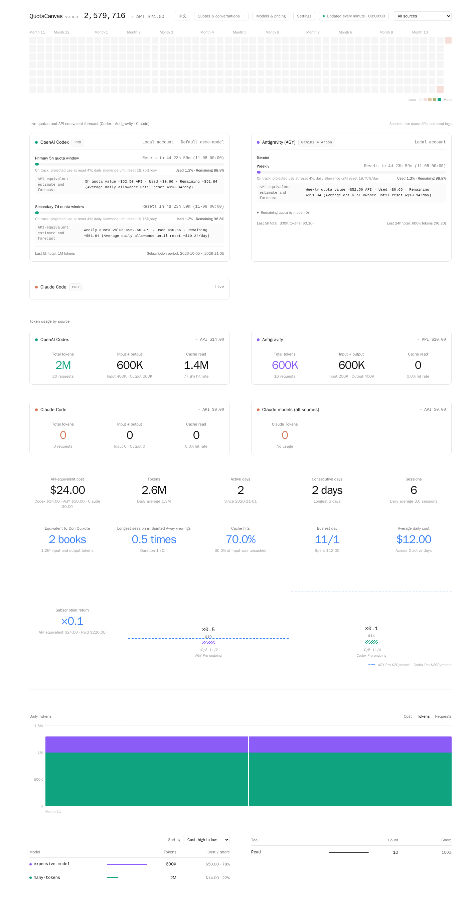

# QuotaCanvas

[简体中文](README.md) · 繁體中文 · [English](README.en.md)

在瀏覽器查看 Codex、Antigravity、Claude Code 和 DeepSeek Harness 的本機 AI 用量。支援的 Agent 還可顯示額度、讀取對話和排程發送訊息。

**v0.0.1 · Linux / Windows x64 · [MIT 授權](LICENSE)**



## 安裝與啟動

### Windows（x64）

1. 在 GitHub **Releases** 下載 `QuotaCanvas-v0.0.1-windows-x64.zip`，解壓整個資料夾。
2. 雙擊 `QuotaCanvas.exe`。首次啟動會要求設定面板密碼，無需安裝 Python。
3. 點「打开本机面板」，或在瀏覽器開啟 [http://127.0.0.1:8088](http://127.0.0.1:8088)。關閉主視窗會停止服務。

可在主視窗修改密碼、設定登入 Windows 後自動啟動，以及開啟 tok/s 懸浮窗。要監看其他主機，在「监控来源」選「远程」，填入對方的面板網址及密碼。若遠端入口使用 Cloudflare Access，再按「在浏览器中验证 Access」。設定與歷史存放在 `%LOCALAPPDATA%\QuotaCanvas`，更新時可保留。

### Linux

需要 Python 3.10 或更新版本。Debian / Ubuntu 如缺少虛擬環境支援，先執行 `sudo apt install python3-venv`。

```bash
git clone https://github.com/iezx/QuotaCanvas.git
cd QuotaCanvas
python3 -m venv .venv
. .venv/bin/activate
python -m pip install -r requirements.txt
python server.py
```

首次啟動時，在終端設定 10–256 字元的密碼。瀏覽 [http://127.0.0.1:8088](http://127.0.0.1:8088) 並登入。按 Ctrl+C 停止服務。

用同一個 Linux 帳戶登入 Agent 和執行 QuotaCanvas。日誌預設位於 `~/.codex`、`~/.gemini/antigravity-cli`、`~/.claude` 和 `~/.dsh`。其他位置可用 `CODEX_HOME`、`AGY_HOME`、`CLAUDE_HOME` 和 `DSH_HOME` 指定。

## 使用面板

- **總覽**顯示 tokens、API 等價費用和近期輸出速度，可按 tokens 或費用排列模型。模型名稱依日誌記錄，未定價的模型仍計入 tokens。
- **模型與 API 價格**可選擇現有模型或輸入自訂 ID，手動設定輸入、快取讀取、快取寫入和輸出價格，單位為 USD / 100 萬 tokens。儲存後重算費用。
- **查價**可使用本機 Agent 查詢或排程查詢。也可複製面板上的提示詞給其他 AI，再匯入回傳的 JSON。核對來源後按「應用建議」即可生效。
- **本機對話**可讀取、建立和延續支援的對話，並排程發送。Codex 的原生提問會在對話下方顯示。輸入 `/help` 查看目前 Agent 支援的指令。
- **設定**可查看已完成任務的平均 tok/s 和額度耗盡紀錄，也可隱藏郵箱、設定訂閱日期及限制登入失敗次數。

## Linux 命令參考

在專案目錄啟用 `.venv` 後執行。更換啟動參數或執行管理命令前，先停止既有程序。

| 命令 | 用途 |
| --- | --- |
| `python server.py` | 啟動面板，預設只監聽 `127.0.0.1:8088` |
| `python server.py --lan-host 192.168.1.10` | 同時監聽本機和指定的內網 IPv4。請換成主機的實際地址 |
| `python server.py --host 0.0.0.0` | 監聽所有 IPv4 介面。直接對外提供服務時，由防火牆及 HTTPS 反向代理保護入口 |
| `python server.py --port 9090 --interval 60` | 使用 9090 連接埠，每 60 秒更新用量 |
| `python server.py --set-password` | 在終端重設密碼，完成後重新啟動面板 |
| `python server.py --disable-remote` | 持久停用 Tunnel 連接，保留 Cloudflare Access 設定 |
| `python server.py --once` | 採集一次，輸出摘要後結束 |
| `python server.py --web-cache "$HOME/.cache/quotacanvas/web"` | 從本機磁碟的靜態頁面快照提供網頁 |
| `python server.py --help` | 查看全部啟動參數 |

更新時保留 `data/`。若程式放在不支援私有權限的磁碟，使用 `export QUOTACANVAS_DATA_DIR="$HOME/.local/share/quotacanvas"`，並在每次啟動及重設密碼時使用同一個路徑。

## Windows 命令參考

在解壓資料夾開啟 PowerShell，並先關閉正在執行的 QuotaCanvas。

| 命令 | 用途 |
| --- | --- |
| `.\QuotaCanvas.exe --lan-host 192.168.1.10` | 保留本機入口並監聽指定內網 IPv4，請替換為主機的實際地址 |
| `.\QuotaCanvas.exe --port 9090` | 使用 9090 連接埠 |
| `.\QuotaCanvas.exe --set-password` | 開啟密碼重設視窗，儲存後重新開啟程式 |
| `.\QuotaCanvas.exe --disable-remote` | 持久停用 Tunnel 連接，保留 Cloudflare Access 設定 |
| `.\QuotaCanvas.exe --help` | 查看啟動參數 |

## 透過 Cloudflare 從外網存取

### 安裝 cloudflared

在執行面板的主機安裝。Debian / Ubuntu 可使用下列指令。其他 Linux 發行版請依套件頁選擇對應安裝方式。 [Cloudflare 官方套件](https://pkg.cloudflare.com/index.html)

```bash
sudo install -d -m 0755 /usr/share/keyrings
curl -fsSL https://pkg.cloudflare.com/cloudflare-main.gpg | sudo tee /usr/share/keyrings/cloudflare-main.gpg >/dev/null
echo 'deb [signed-by=/usr/share/keyrings/cloudflare-main.gpg] https://pkg.cloudflare.com/cloudflared any main' | sudo tee /etc/apt/sources.list.d/cloudflared.list
sudo apt update
sudo apt install cloudflared
cloudflared --version
```

**Windows** 請下載並安裝 x64 MSI，重新開啟 PowerShell 並執行 `cloudflared --version`。確認可用後重啟 QuotaCanvas，再按下方步驟設定。 [Cloudflare 官方下載](https://developers.cloudflare.com/tunnel/downloads/#windows)

### 設定 Tunnel + Access

1. 準備一個由 Cloudflare 託管 DNS 的網域，選擇尚未使用的子網域，例如 `dashboard.example.com`。在 Zero Trust 啟用郵箱驗證碼或其他登入方式。
2. 建立自訂 API Token，把帳戶與 Zone 資源分別限定在目標帳戶和網域。 [建立 API Token](https://developers.cloudflare.com/fundamentals/api/get-started/create-token/)
3. 在 QuotaCanvas **設定 → Cloudflare Tunnel + Access** 填寫子網域、允許登入的郵箱和 API Token。依序按「保存 → 檢查配置 → 啟用」。
4. 顯示「隧道已連接」後，用瀏覽器開啟 HTTPS 網域，先完成 Cloudflare Access 驗證，再登入面板。

| 範圍 | Token 權限 | 級別 |
| --- | --- | --- |
| Zone | Zone | Read |
| Zone | DNS | Edit |
| Account | Cloudflare Tunnel | Edit |
| Account | Access: Apps and Policies | Edit |
| Account | Access: Organizations, Identity Providers, and Groups | Read |

若 **Access: Apps** 和 **Access: Policies** 分開顯示，兩項都選 Edit。最後一項也可能顯示為 **Access: Organizations**。

允許 `cloudflared` 對外連接 TCP 或 UDP 7844。Tunnel 使用本機回環作為源站，可另外用 `--lan-host` 保留內網入口。只允許可信任的使用者登入，因為面板能向本機 Agent 發送指令。 [Cloudflare 網路連線檢查](https://developers.cloudflare.com/cloudflare-one/networks/connectors/cloudflare-tunnel/troubleshoot-tunnels/connectivity-prechecks/)

### 開機啟動與停用

在設定中開啟「面板啟動時自動連接隧道」，已啟用的 Tunnel 會在面板啟動後自動連線。關閉後可從本機或內網按「啟動連接」。立即中斷公網入口請按「停用」。

若要讓面板隨 Linux 開機啟動，把專案及其 `.venv` 安裝在 `~/.local/opt/quotacanvas`，先手動啟動一次完成密碼設定。將下列內容存為 `~/.config/systemd/user/quotacanvas.service`。

```ini
[Unit]
Description=QuotaCanvas

[Service]
WorkingDirectory=%h/.local/opt/quotacanvas
ExecStart=%h/.local/opt/quotacanvas/.venv/bin/python server.py
Restart=on-failure

[Install]
WantedBy=default.target
```

```bash
loginctl enable-linger "$USER"
systemctl --user daemon-reload
systemctl --user enable --now quotacanvas.service
```

查看狀態用 `systemctl --user status quotacanvas.service`。停止面板並關閉開機啟動用 `systemctl --user disable --now quotacanvas.service`。
